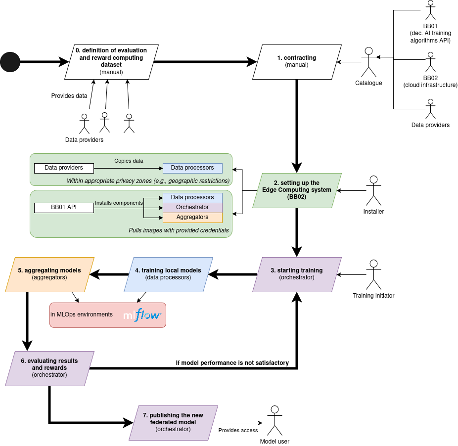
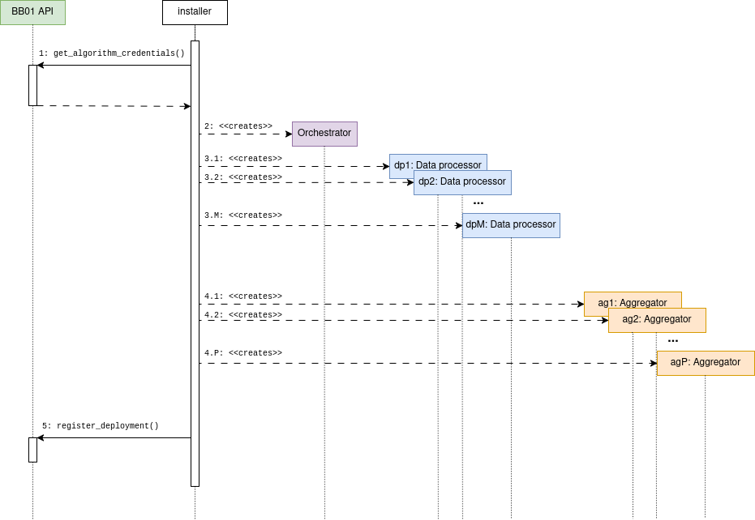

# Dynamic behavior of the BB

## Overview

**Preliminaries:**
1. data providers shall construct an appropriate [test set](#test-set-criterion).
2. BB01, data providers and BB02 (infrastructure provider) shall sign PTX-contracts.
3. The installer shall [setup the system](#system-setup).

After setting up the system, through BB01's API, training initators can start the federated learning process. Federated learning's clients are the data processors, having data providers' data. They compute local model updates by training AI models until convergence. The locally convergent models are aggregated by (possibly hierarchically) aggregators.

## Appendix
### Test set criterion
Data providers shall construct a test dataset conforming the following rules:

1. the dataset shall represent well enough the combined dataset of the data prviders (i.e., minimizing the KL-divergence between the distribution of the test set and combined set)
2. none of the data providers shall access the test set. Rationale: if any of the data providers would process the test dataset, it could create an efficient attack even against the reputation-aware (DeltaRep) aggregation.

### System setup

To setup the system, the installer shall request credentials from BB01's API to download corresponding `docker` images for BB01's internal components.

With these credentials, the installer can deploy the system either in a `docker compose` setup, or on [BB02](https://github.com/Prometheus-X-association/edge-computing/tree/main/kubernetes/deployment/training).

Lastly, the installer shall register its deployment at BB01's API.