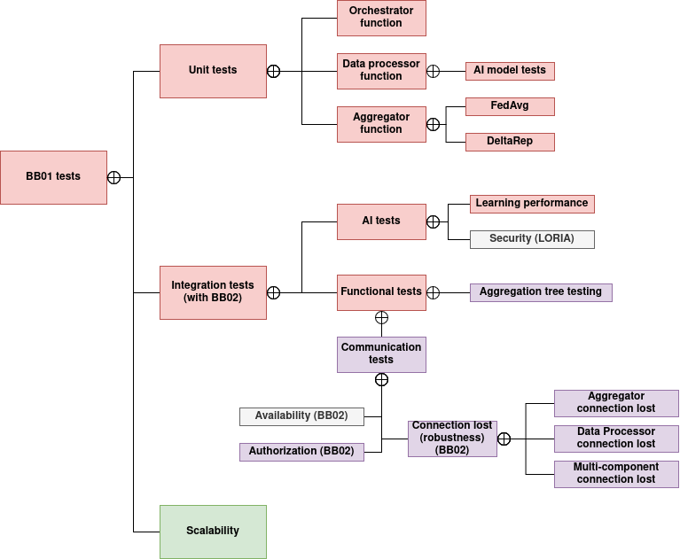

# Test specification

## Overview

## Test plan
For our unit test's we use python's pytest framework. When testing our components (eg. aggregator, data_provider or orchestrator) we choose a path when we test their functionality through their endpoints. So for this every pytest's prerequisite is that the componet's container which is under test should be up and running. Pytest can handle these by itself, it the container is required for every test and it will be started up onece before the 1st test and will be stopped after all the tests run.

We have also automated these test's with Github Actions workflows. These testing worklfows will be triggered by a `Pull-request` towards the repositry's main branch or will be run on every Sunday after 8 P.M time (time of Budapest, CET timezone). Or the workflow can also be triggered manually.

### Test cases

| id     | short description             | tested components       | corresponding requirement             |
|--------|-------------------------------|-------------------------|---------------------------------------|
|TC1     | Aggregator testing - FedAvg   | aggregator              | F1.3, F1.3.1, F1.3.1.1, F1.3.1.2, F1.4|
|TC2     | Aggregator's Mlflow authentication testing| aggregator  | E1                                    |

#### TC 1 -- Aggregator testing - FedAvg
This test case servers the purpose of testing the aggregator's `FedAvg` model aggregation function through it's `do_aggregate` endpoint. For this purpose we created some simple models which will serve as client_models as an input for the aggregator. These 3 models were trained on the mnist dataset (see aggregator_test python notebook under 05_test/aggragator_test). We wanted some weak learners which will be combined by the aggregator so we have made an imbalanced data partition of the train data on purpose (see mnist_partitioner python notebook under 03_dev/share_sim).
The test case consist 2 pytest unittest (05_test/aggragator_test/aggregator_test.py):
* `test_fedavg_aggregation`: The 1st test calls the do_aggregate endpoint after the client_models are retrieved from our cloud server through an ssh tunnel. This test only checks whether the aggregation by FedAvg algorithm was successful by checking the response of the endpoint. If it was `200 OK` than the test passed.
* `test_pull_fedavg_model`: This test will pull the previously aggreagted model from it's mlflow server and comapres it's performance with the client models. If both the loss of the aggregated model is less than the weakest client model's loss and the accuracy of the aggregated model is higher then the weakest client model's accuracy than we consider the aggregation successful and the test passes.

#### TC 2 -- Aggregator's Mlflow authentication testing
To ensure proper access to the models we introduced the roles of aggregator (can upload and download models) and model_user (can only download models). In the Mlflow auth testing (see mlflow-auth-test under 05_test/mlflow_auth_test). The tests ensure that:
* An unauthenticated user can't do any operations with the mlflow server;
* A user authenticated as model_user can only pull existing models from the mlflow server but can't push a model;
* A user authenticated as aggregator can both push a trained model and can pull existing models from the server.
