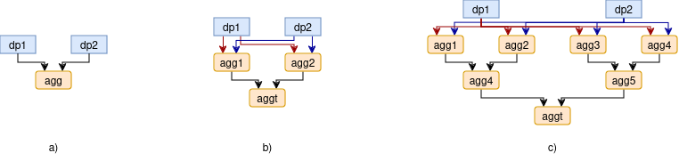
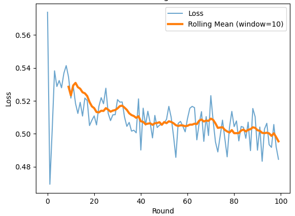

# Decentralized AI training BB

This building block allows its users to create a machine learning model in a *federated learning* manner.

## Design Document
See the design document [here](01_docs/design-document.md).

## Building instructions
One can build the BB's images by running:

```bash
$ cd 04_deploy
$ ./build_images.sh
```

## Running instructions
There are two types of deployment of this BB.

### Docker compose-based test environment

For a simple test deployment in `docker compose`, one can run the following commands:
```bash
$ cd 04_deploy
$ ./deploy.sh --test-deploy
```

### Kubernetes-based production deployment
For a full-fleged deployment, follow the procedure below:

1. Run the following comands (on local computer) to build and push the BB's images to a repository:
```bash
    $ cd 04_deploy
    04_deploy$ ./deploy.sh --cluster-deploy
```

2. For running BB01's API (optional, if needed), follow the instructions below:

A. Publish files for BB01-API from local computer to e.g. `cloud.bme.hu` (if it is your responsibility to run it). Note that it will publish itself to the PTX-Catalogue!
```bash
    04_deploy$ cd api
    04_deploy/api$ ./deploy_to_fured.sh <port> <password>
```

B. Register your service and offers in [VisionsTrust's catalogue](https://visionstrust.com/). Fill `04_deploy/api/creds/exchange.env` with your own credentials, and HTTPS URLs accordingly (PDC tokens are given by VisionsTrust's website)

C. Set BB01's API up to provide PDC access with the following codes:
```bash
 cloud@fured.cloud.bme.hu:~/bb01_api$ make build && make setup
```

3. Follow cluster deployment instructions in [BB02 Edge computing](https://github.com/Prometheus-X-association/edge-computing/tree/main/kubernetes/deployment/training).

4. Register your deployment using BB01's API through a PDC interface.

5. Remove your deployment as needed from BB01's API through PDC interface.

## Example usage

### Core functionality
The BB itself provides two endpoints:
- an interface to its Orchestrator component
- an [`MLFLow server`](https://mlflow.org/docs/latest/ml/) to provide access for the trained AI model

To use the BB, send the following requests to the designated endpoints:
| Endpoint                    | Example input | Expected output   |
| --------------------------- | ------------- | ----------------- |
| orchestrator/start_training | {[`aggregation_tree`](01_docs/dynamics.md#BB01-usage)}         | 200 OK, `{"model_uri": "top-level-aggregator/mlflow:324seuioz5u"}` |
| top-level-aggregator/mlflow | `mlflow.tensorflow.load_model(model_uri) `              | a loaded `tensorflow` model instance   |

### BB01 API via PDC
BB01 also provides credentials for project partners through Prometheus-X Data Connectors (PDCs). For more details, please refer to [the documentation](01_docs/dynamics.md).


## Unit testing

For unit testing, we set up test processes as [GitHub Actions](https://github.com/Prometheus-X-association/decentralized-ai-training/actions).
Some of the test cases are automatically, and other ones are manually triggered.

Besides automated test that are fundamental in our CI/CD development process, one can also run unit tests on a local computer.

For detailed unit test design, see [Test documentation](01_docs/tests.md).

### Setup test environment

```bash
$ cd 04_deploy
$ ./deploy.sh --test-deploy
```

### Run tests
### Expected results

## Component-level testing

For component level testing, we provide example executions of the BB.
For details, check the [component integration test notebook](05_test/integration_test.ipynb).

In this notebook, we provide tests for three aggregator-tree compositions as shown below:
.

As an integration test, we check whether or not the system is capable of training a federated neural network.

### Setup test environment
1. To properly configure the system, we have to use the following configuration for the architectures given in the above figure:

| architecture | Docker Compose Configuration | Aggregation Tree                  |
|--------------|------------------------------|-----------------------------------|
| a)           | `shallow_docker-compose.yaml`| `AGGREGATION_TREE_DC_SHALLOW`     |
| b)           | `multi2_docker-compose.yaml` | `AGGREGATION_TREE_DC_TWO_LEVELS`  |
| c)           | `multi3_docker-compose.yaml` | `AGGREGATION_TREE_DC_THREE_LEVELS`|

2. After selecting the proper architecture, one shall copy the corresponding *Docker Compose Configuration file* from `04_deploy/docker-configs` to `04_deploy` and rename it to `docker-compose.yaml`.

3. Run command: `04_deploy$ ./deploy.sh --test-deploy`

### Run tests
4. Use `05_test/integration_test.ipynb` and select the proper *Aggregation Tree* that corresponds to the selected architecture.
5. Run through the cells of the notebook.
6. Check whether the resulted model trains or not. I.e., whether or not it can produce a federated model of which test losses are showing a decreasing trend.

### Expected results
Testers shall observe a decreasing trend in test losses as the system trains the federated neural network.

The expected result shall look similar to the below figure.

