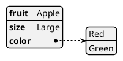
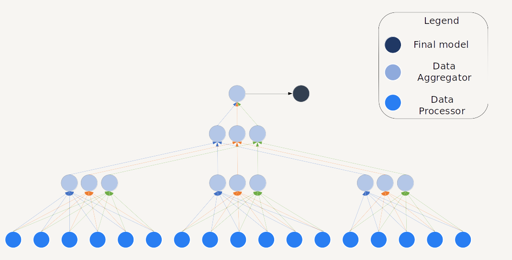
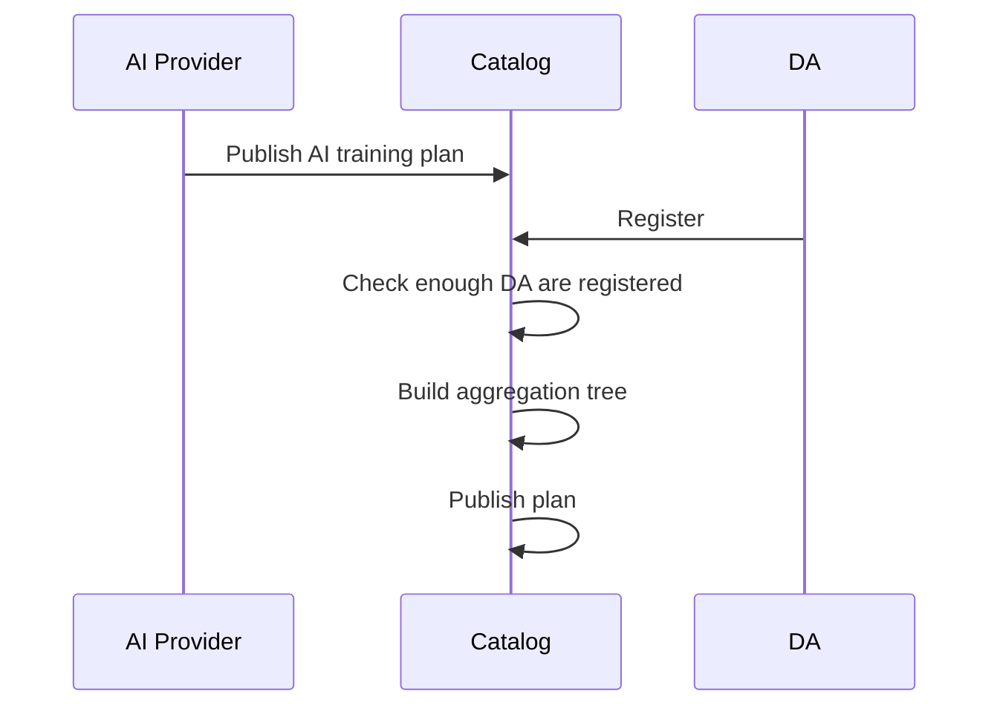
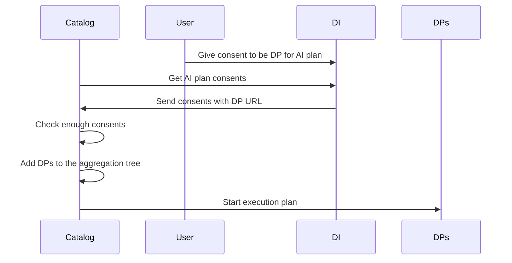
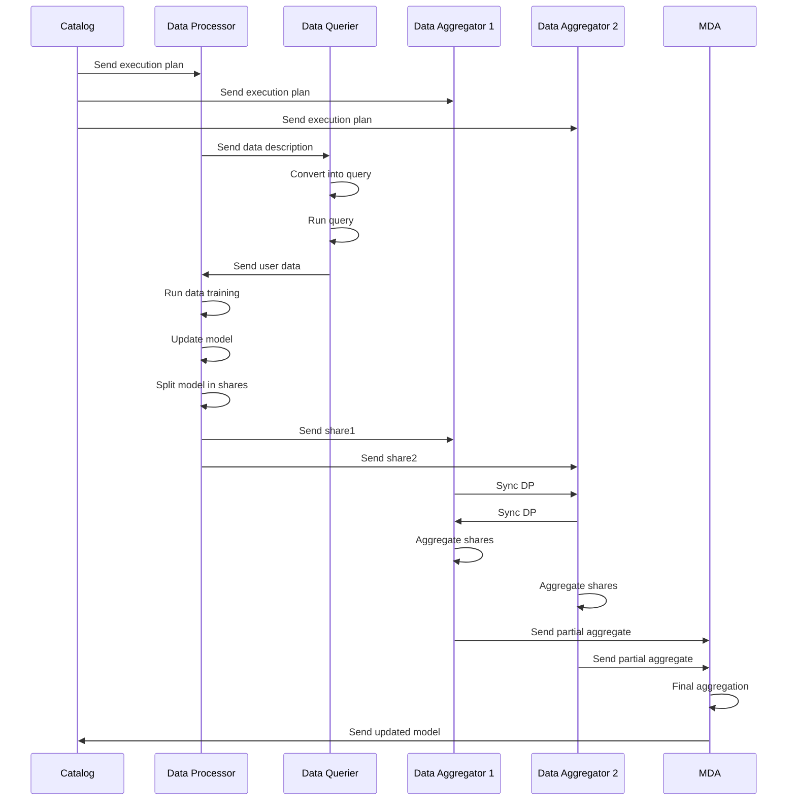

# Decentralized AI training Design Document

The goal is to be able to train AI models, without the need to centralize training data. This is particularly virtuous in the case of training on personal data, which is complicated to centralize for reasons of privacy, security, and regulation. 

We present here an architecture allowing decentralized AI training on nodes, while ensuring trust, accuracy and trustworthiness.


## Technical usage scenarios & Features


### Features/main functionalities

- AI provider publishes an AI computation plan to the Catalog/Registry including initialized AI model, target data, and how data should be used 
- An execution plan is made based on the computation plan, including the involved Data Aggregators, responsible for anonymous computation
- Once enough users gave consent to participate, the execution plan is run and eventually produce a trained AI model
- Contributing nodes could be selected or excluded depending on a reputation score
- Model accuracy and trustworthiness could be evaluated

### Technical usage scenarios

Enable the training of AI models without disclosing user data at any time. 
A decentralized protocol allows to make computations directly to the data source, and share AI model updates, without the need of a central actor.

Thanks to this, one can train AI models on a huge variety of user data, that is normally very hard 
to access, for reasons of privacy, security, and regulation. 


## Requirements

_High-level BB requirements with identifiers.
eg * **R1.** BB MUST communicate with [other BB]_

_See also the Requirements spreadsheets
Functional requirements should be extended with extra-functional ones:
Timeliness (expected response time@request size), Througput (number of requess served by the BB),etc.
These may be defined later with UCs but have to be indentified here and be part of configuration/deplomyent options_


## Integrations

_See "01_BB Connections" spreadsheet_

### Direct Integrations with Other BBs

_What other BBs does this BB interact with directly (without the connector)?
How?
Why?_

- *Catalog*. The "registry", a new Catalog component, allows to define execution plans to train AI models

- *Contract*. Contract bewteen AI provider, Data Consumer and Data Aggregators to train the model 

- *Consent*. The user gives consent to become a Data Processor, i.e. be part of an execution plan to train AI model on data

- *Edge computing - AI processing*	Allow generic asynchronous execution, e.g. an AI model update from user data

- *Trustworthy AI*. The AI model should be trustworthy

- *PLRS*. The PLRS provides user data and infrastructure for Data Processors

### Integrations via Connector

_What other BBs does this BB integrate with intermediated by the connector?
Why?_


## Relevant Standards

### Data Format Standards

_Any data type / data format standards the BB adheres to_

### Mapping to Data Space Reference Architecture Models

_Mapping to [DSSC](https://dssc.eu/space/DDP/117211137/DSSC+Delivery+Plan+-+Summary+of+assets+publication) or [IDS RAM](https://docs.internationaldataspaces.org/ids-knowledgebase/v/ids-ram-4/)_


## Input / Output Data

_What data does this BB receive?
What data does this BB produce?
If possible, elaborate on the details (data format, contents, etc) and also add potential data requirements._

_Mermaid has no such feature, but you may use PlantUML to automatically visualize JSON schemata; for example:_



_Creating the diagram via the PlantUML JAR:_

```shell-session
$ java -jar plantuml.jar -tsvg json.puml
```

_Gives:_


_Please add a short description, also estimating the workload for a typical transaction of your BB (e.g. "100.000 record/submission", "traces of n*10.000s of events", etc.)._

## Architecture

The main roles in the architecture are the following:

- Data Processor (DP): a node with authorized access to user data. This is where model updates are computed.
- Data Aggregator (DA): a server node run by a trusted party that is able to receive partial model updates and perform aggregations on it.
- Main Data Aggregator (MDA): a specialized DA that computes the final model aggregation including all the DP contributions.
- AI provider: an organization that publishes an AI training plan
- Catalog: it stores and publishes the AI training plans  
- DI: Data intermediary, necessary to store user consents
- Users: they express their explicit consent to contribute to an AI training plan 




## Dynamic Behaviour


### AI training plan publication

An AI Provider requests the Catalog to publish an AI training plan. It includes:

- Initialized AI model
- The data format to use for training
- Algorithms to contribute
- A user-friendly description

On the other side, Data Aggregators (DA) register to be part of an execution plan. This execution plan includes an Aggregation Tree,  describing how the training data should be split, and who should be MDA, i.e. the last aggregator producing the final model.
Once there are enough registered DA, the Catalog computes the Aggregation Tree. 
  
ℹ️ The Aggregation Tree is not complete yet, as the leafs, i.e. the DP, are not known yet. 

Then, the Catalog publishes the plan. A user should be able to consent to this plan to become a Data Processor (DP).

Number of DA
The minimal number of registered DA to guarantee security is 3, one of them being the MDA. 
Increasing the number of DA offer better security, as it reduces the collusion impact (i.e. 2 corrupted DA that work together to reveal model updates) as well as server loads (less work for each DA).
On the other hand, it also increases complexity, network load and risk of failures. 
So this is a trade-off to chose between those contraints.



### Consent

Once execution plans are published by the Catalog, a user must be able to give consent to be able to contribute.
Once enough consents have been reached (which is a parameter of the execution plan), the Catalog can start the plan by requesting all the DP through their registered URL.



### Protocol execution


The execution starts by the Catalog sending the execution plan to all the DPs and DAs.

ℹ️ The DPs are added to the Aggregation Tree as leafs. They are transmitted to the DAs, that need to know which DP contribute. However, this information is not transmitted to the DPs as it is not required and might hurt privacy. 




### Query data

Once it receives the execution plan, the first thing to do for a DP is to query user data. For this, the DP will request the Data Querier (DQ) and transmit the data format included in the execution plan.

ℹ️  Depending on the edge architecture, the DQ could actually be part of the DP.

The data format is then interpreted by the DQ to be translated into a data query. Thanks to his, the user data is queried and retrieved by the DQ.
Then, the data is translated, if needed, in the expected format. 
Finally, the data is sent back to the DP.

ℹ️ The Data description format must be understood by all DQ to be correctly interpreted. The translation into a data query is up to each DQ and will depends on their own data API.


### Local Data Processing

Update model

The DP has now:

- The user data
- The initialized AI model
- The algorithms to contribute to the model

ℹ️ The algorithms can (should?) be included direclty into the AI model, e.g. with a pickle format.

Then, the DP can locally train the model based on user data, and update the model weights.  

⚠️ Depending on the AI model and data volume, this task can be quite computational heavy.  

#### Split model in shares

Once the local training is done, the data is split using a secret sharing technique. A security parameter $S$ determines the number of shares, a parameter retrieved in the execution plan metadata. 
Let $x$ be the training result, then the user creates the shares  $\mathbf{x}_i = \mathbf{x} + b_i$, where $b_i$ is a noise vector such that $$\sum_{i=1}^S b_i = 0$$.

⚠️ It means that each share is the complete model with noise on the weights. This introduces a computational and storage overhead that might be problematic for large models.

#### Send shares to DAs

Each share is sent to the assigned DAs, as attributed in the execution plan. Once it is done, the DP removes all the local data (user data, model update, etc) that is not necessary anymore.

ℹ️ It is important to have a unique id for each execution plan, associated with each step of the protocol, to be able to run several plans in parallel.


### Aggregation

Each DA is contacted with new shares. When it receives one, it stores it locally while waiting to have all the expected shares.

ℹ️ The number of expected share is known thanks to the Aggregation Tree

Then, it launches the aggregation step: all shares are aggregated (summed) together to produce a new intermediary model. The sum of contributions is also saved. The final result is sent to the parent, to do the same thing. If the parent is the MDA, producing the last share produces the final de-noised model.

### Synchronization between leafs DAs

The DAs must imperatively aggregate the same number of shares, coming from the same contributors. Otherwise, the final aggregation will not correctly remove the noises and will result in a wrong result.

Because of their decentralized and versatile nature, we cannot expect all DP to make their contribution in time: network and computation failures can occur anytime.     
It is then necessary to have synchronization between the DAs of the first tree level (those receiving shares from DP). To this end, each DA sends the list of the received DPs.

Different synchronization strategies can be used:

- Temporal: after a fixed delay started after receiving the first share, a sync is done.
- Threshold: the sync is started as soon as a DA reaches a minimum threshold of contributions.
- Hybrid: a fixed delay is started after after the treshold is reach

Once all the DP from the DA are reunited, the intersection is computed.
If the minimal contributing threshold is reached on the intersection, the aggregation can be computed.
If the intersection does not reach the threshold, another sync can be made later, to give more time to the DP to finish their work.

⚠️ The threshold can never be reached and thus the protocol never converges. A garbage collector is then necessary, to discard an execution plan and all related data when it’s been waiting for too long on the Aggregation level. 

ℹ️ As the tree of DAs is known, each non-leaf DA knows how many shares it must receive, which makes the sync useless for the upper part of tree.

ℹ️ When the Aggregation Tree is large enough to divide the DA into groups (cf the Aggregation Tree schema), the sync is only made inside a group.  

Compute and send intermediate aggregate to parent

Once the intersection list of contributing DP is computed, each DA can now discard any DP not included in the list.
Then, it computes the intermediate aggregate from the shares of each DP, and send it to the parent DA.

    
### Final aggregation

The last DA parent is the Main Data Aggregator (MDA). Once all the expected intermediate aggregates are received, it triggers the final aggregation. Depending on the model, it may simply sum as for the DAs (typically sufficient for a naive bayes model), or compute an average, thanks to the sum of weights + the sum of contributions.

The final model is then sent and saved to the Catalog and can be retrieved by the AI provider.


## Configuration and deployment settings

_What configuration options does this BB have?
What is the configuration format?
Provide examples.
How is the component logging the operations? What are the error scenarios? What are the limits in terms of usage (e.g. number of requests, size of dataset, etc.)?_


## Third Party Components & Licenses

_Does this BB rely on any 3rd-party components?
See also the "EDGE third party/background components" spreadsheet.


## Implementation Details

_This is optional: remove this heading if not needed.
You can add details about implementation plans and lower-level design here._


## OpenAPI Specification

_In the future: link your OpenAPI spec here._

## Test specification

_Test definitions and testing environment should be availaible, and the tests should be repeatable._

### Test plan
Testing strategy, tools and methods chosen, methods for acceptance criteria.
To be detailed.

### Unit tests

_Here specify the test cases for the components inside the BB.  
Candidates for tools that can be used to implement the test cases: JUnit, Mockito, Pytest._

### Integration tests

_Here specify how to test the integration of the components inside the BB.  
Candidates for tools that can be used to implement the test cases: K6, Postman, stepci, Pact  
An example tutorial is available [here](https://github.com/ftsrg-edu/swsv-labs/wiki/2b-Integration-testing)._

### UI test (where relevant)

_Candidates for tools that can be used to implement the test cases: Selenium_
